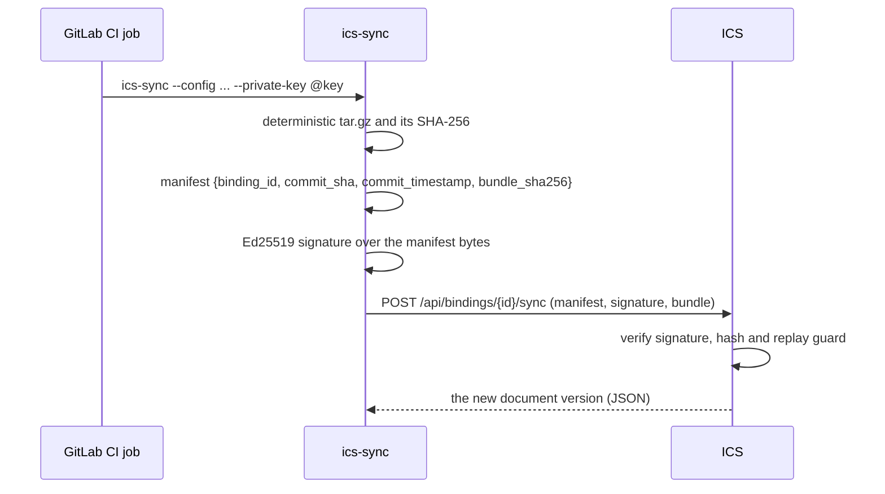

<div align="center">

<a href="https://github.com/inprojectspl/ics">
  <picture>
    <source media="(prefers-color-scheme: dark)" srcset="docs/images/logo-lockup-white.svg">
    
  </picture>
</a>

## ics-sync

### Publish a GitLab repository to ICS on every push

A small Go CLI that packs a repository, signs the upload with Ed25519 and publishes it as a new
version of a document in [ICS (Internal Content Sharing)](https://github.com/inprojectspl/ics),
straight from a GitLab CI job.

[](./LICENSE)
[](./go.mod)
[](https://github.com/inprojectspl/ics-sync/pkgs/container/ics-sync)

[User guide](https://inprojectspl.github.io/ics-sync/) ·
[Quick start](#quick-start) ·
[Binding file](#the-binding-file) ·
[CI job](#ci-job-template) ·
[How it works](#how-it-works) ·
[Running by hand](#running-it-by-hand) ·
[Development](#development)

</div>

<br>

## Highlights

- **No access to GitLab needed.** ICS never calls GitLab: the repository's own pipeline pushes
  to ICS, so no deploy tokens, webhooks or admin rights are involved.
- **Signed and replay-safe.** Every upload carries a manifest signed with the binding's Ed25519
  key; ICS checks the signature, the bundle hash and that the commit time moves forward.
- **Reproducible bundles.** Sorted entries, fixed modes and timestamps: the same tree always
  gives a byte-identical archive.
- **Safe by default.** Git metadata (and the job token GitLab Runner writes into `.git/config`),
  symlinks and other non-regular files never leave the job.
- **Tiny and streaming.** A single static binary in a small image; the bundle is streamed from
  disk to the network, so memory use does not grow with the repository.

## Documentation

The [user guide](https://inprojectspl.github.io/ics-sync/) walks through the setup with screenshots of the ICS
binding dialog and covers the binding file, CI job recipes, key rotation and troubleshooting.

## Quick start

1. **In ICS**, open the GitLab binding dialog of a document and create a binding. You get a
   `binding_id` and a PEM private key, shown **only once**. The dialog also shows the binding
   file and the CI job below, filled in for your document and instance.
2. **In the GitLab project**, add the private key as a CI/CD variable (see below).
3. **In the repository**, commit the binding file to the root and add the job to
   `.gitlab-ci.yml`. The next push to the default branch publishes a new version.

The image to use in the job:

```
ghcr.io/inprojectspl/ics-sync:1
```

`:1` is the stable major version: it moves to every `v1.x.y` release and becomes `:2` only for
a breaking change in the config format or the sync protocol. Pin a release (`:1.1.1`) or a
commit (`:<sha>`) for fully reproducible jobs; see [Image tags](#image-tags).

### CI/CD variables

| Variable | Type | Flags | Value |
|---|---|---|---|
| `ICS_PRIVATE_KEY` | **File** | Protected (masking is not available for File variables) | the PEM private key, including the `-----BEGIN ...` and `-----END ...` lines |
| `ICS_ENDPOINT` | Variable | any | the base URL of your ICS instance, e.g. `https://ics.example.com`; can also be set in the job's `variables:` |

For a **File** variable GitLab exposes the **path of a temporary file**, not its content, which
is why the job passes `@$ICS_PRIVATE_KEY`: the `@` prefix tells the CLI to read the PEM from that
path. Prefer it to a literal key on the command line, where other processes could see it.

## The binding file

Committed to the repository root (ICS suggests the name `.inprojects.ics`; any path works with
`--config`). It holds the `binding_id` issued by ICS, the **public** key for people auditing the
setup, and what to publish.

```yaml
version: 1
binding_id: 00000000-0000-0000-0000-000000000000
public_key: |
  -----BEGIN PUBLIC KEY-----
  MCowBQYDK2VwAyEA...
  -----END PUBLIC KEY-----
publish:
  source: .                # path relative to the working directory of the job
  kind: md_collection      # md_single | md_collection | html_bundle
  # exclude:
  #   - "node_modules/**"
  #   - "*.test.*"
metadata:
  title: "Team handbook"
```

<details>
<summary><b>Field reference</b></summary>

<br>

| Field | Required | Description |
|---|---|---|
| `version` | yes | always `1` |
| `binding_id` | yes | UUID issued by ICS; identifies the binding on the server |
| `public_key` | no | PEM public key of the pair. ICS verifies against the key it stores; the field is for people checking the setup by hand |
| `publish.source` | no (default `.`) | what to publish: `.` is the whole repository, `docs/` one folder, `dist/` a build artifact of an earlier job |
| `publish.kind` | no | the document type in ICS. ICS checks the content against the document's own type; the field documents the intent |
| `publish.exclude` | no | globs left out of the bundle, see below |
| `metadata.title` | no | informational only: the CLI does not send it and the document keeps the title set in ICS |

**Excludes.** Each pattern is matched against the path relative to `publish.source` and against
the file name. `dir/**` leaves out `dir` and everything below it (only a trailing `/**` is
supported, `**/name` is not); any other pattern uses Go's
[`path.Match`](https://pkg.go.dev/path#Match) syntax, for example `*.test.*` or `docs/draft.md`.

**Always left out:** `.git` directories and the `.git` files of submodules, symlinks and other
non-regular files, and empty directories.

**Strict parsing.** A key the CLI does not know (a typo such as `soruce`) or a malformed exclude
pattern stops the CLI before anything is packed, so a typo cannot widen what is published.

</details>

## CI job template

```yaml
ics:sync:
  stage: deploy
  image:
    name: ghcr.io/inprojectspl/ics-sync:1
    entrypoint: [""]
    pull_policy: always
  rules:
    - if: $CI_COMMIT_BRANCH == $CI_DEFAULT_BRANCH
  variables:
    ICS_ENDPOINT: "https://ics.example.com"
  script:
    - ics-sync --config .inprojects.ics --private-key "@$ICS_PRIVATE_KEY"
```

<details>
<summary><b>Why each field is there</b></summary>

<br>

| Field | Why |
|---|---|
| `image.name` | the CLI image; `:1` picks up new `1.x` releases without editing the job |
| `image.entrypoint: [""]` | the image's entrypoint is the CLI itself; resetting it lets GitLab Runner run the job's `script:` |
| `image.pull_policy: always` | forces a fresh pull of the moving `:1` tag. If your runner allows only `if-not-present`, drop the field and pin a release tag |
| `rules` | run the sync only on the default branch; extend it for tags if you publish releases |
| `ICS_ENDPOINT` | the ICS URL; can also be a project or group CI/CD variable |
| `--private-key "@$ICS_PRIVATE_KEY"` | `@` means "read the PEM from this path", which is what a File variable holds |

Add `tags:` if your runners need them to pick up Docker jobs.

</details>

## How it works



1. Packs `publish.source` into a deterministic tar.gz: sorted entries, mode `0644`,
   modification time `1970-01-01T00:00:01Z`, PAX headers for UTF-8 names.
2. Computes `bundle_sha256` while writing the bundle to a temporary file.
3. Signs the exact manifest bytes with the private key (unpadded URL-safe base64).
4. Streams a multipart `POST` with the fields `manifest`, `signature` and `bundle`.
5. ICS verifies everything and stores a new version of the document.

**Replay protection.** ICS rejects a push whose `commit_timestamp` is not later than the last
accepted one for the binding. A force push or an amend that moves the timestamp back fails
closed, and so does re-running a job for a commit that was already synced. Rotating the key in
ICS resets the binding's clock.

## Running it by hand

```sh
ics-sync \
  --config .inprojects.ics \
  --endpoint https://ics.example.com \
  --private-key @/path/to/private.pem \
  --commit-sha "$(git rev-parse HEAD)" \
  --commit-ts  "$(git log -1 --format=%cI)"
```

| Flag | Environment | Default |
|---|---|---|
| `--config` | none | `.inprojects.ics` |
| `--endpoint` | `ICS_ENDPOINT` | none (required) |
| `--private-key` | `ICS_PRIVATE_KEY` | none (required); a literal PEM or `@/path/to/key.pem` |
| `--commit-sha` | `CI_COMMIT_SHA` | `manual` |
| `--commit-ts` | `CI_COMMIT_TIMESTAMP` | now (RFC3339) |
| `-v` | none | verbose output on stderr |
| `--version` | none | print the version and exit |

## Image tags

| Tag | Published on |
|---|---|
| `:<commit sha>` | every commit on `main` (immutable) |
| `:latest` | every commit on `main` |
| `:<x.y.z>` and `:1` | a release tag `v1.x.y` |

Pull requests build the image but do not publish it.

## Development

Requires Go 1.26.

```sh
go test ./...
go vet ./...
gofmt -l .
go build -o ics-sync ./cmd/ics-sync
```

CI runs the same checks plus [`govulncheck`](https://pkg.go.dev/golang.org/x/vuln/cmd/govulncheck).
The manifest is a contract with the ICS backend (`Manifest` in
`backend/app/routes/bindings/_models.py` of [ICS](https://github.com/inprojectspl/ics)) and must
stay in sync with it. See [CONTRIBUTING.md](./CONTRIBUTING.md), and report security issues as
described in [SECURITY.md](./SECURITY.md).

## License

ics-sync is released under the [MIT License](./LICENSE). The inProjects.ai name and logo are not
covered by it, see [NOTICE](./NOTICE).

<br>

<div align="center">
  <sub>Built by</sub>
  <br>
  <a href="https://inprojects.ai">
    <picture>
      <source media="(prefers-color-scheme: dark)" srcset="docs/images/inprojects-logo-white.svg">
      
    </picture>
  </a>
</div>
