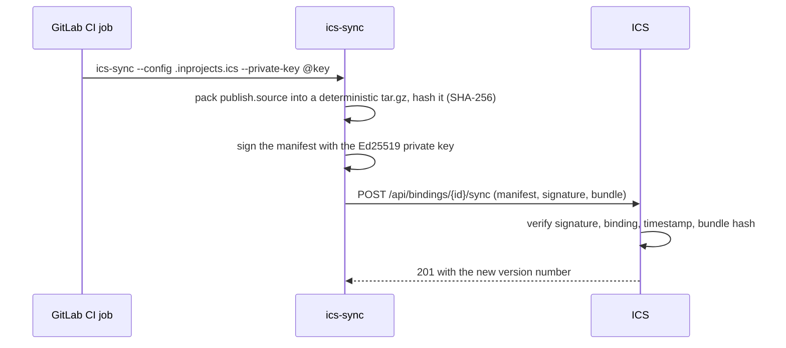

# How it works

The CI job pushes a signed bundle to ICS; ICS never calls GitLab. This page explains what the
signature covers, how ICS refuses replayed or out-of-order pushes, and which files are never
uploaded.

## The trust model

A **binding** connects one ICS document to a key pair. When you create it, ICS generates an
Ed25519 key pair, stores only the public key and shows you the private key once. You put the
private key into a GitLab CI/CD variable; from then on the key is the only credential:

- ICS has no GitLab token, no webhook and no access to the repository. It does not know or
  check which GitLab project the push comes from. The **GitLab repo URL (optional)** field in
  the binding dialog is a link for people, nothing more.
- The sync endpoint, `POST /api/bindings/{binding_id}/sync`, needs no ICS account or session.
  Anyone can call it, but ICS accepts only a request signed with the private key that matches
  the binding's stored public key.
- A binding can publish only into its own document. It cannot read anything from ICS, and the
  response to a successful sync carries only details of the new version.

Because the connection goes from the runner to ICS, a GitLab instance on a private network
works as long as its runners can reach ICS.

## What is signed

ics-sync builds a small JSON manifest and signs its exact bytes:

| Manifest field | Value |
|---|---|
| `binding_id` | from the binding file |
| `commit_sha` | `--commit-sha`, else `$CI_COMMIT_SHA`, else `manual` |
| `commit_timestamp` | `--commit-ts`, else `$CI_COMMIT_TIMESTAMP`, else the current time (RFC 3339, whole seconds) |
| `bundle_sha256` | SHA-256 of the tar.gz bundle |

The signature is Ed25519 over the manifest bytes, sent as unpadded URL-safe base64. ICS checks,
in this order:

1. The binding exists (otherwise `404 binding_not_found`).
2. The signature verifies against the binding's public key (otherwise `403 bad_signature`).
   This happens before ICS reads the bundle, so a forged request costs it very little.
3. The manifest is well formed and names the same binding as the URL (`400 manifest_invalid`,
   `400 manifest_mismatch`).
4. The commit timestamp is not more than 5 minutes in the future (`400 commit_from_future`).
5. The timestamp is later than the last accepted one (`409 replay_rejected`, see below).
6. The SHA-256 of the received bundle equals `bundle_sha256` (`400 bundle_hash_mismatch`).
   Since the hash is inside the signed manifest, the signature covers the bundle content too.

Only then is the bundle unpacked and stored as a new version. The commit SHA is recorded with
the sync (in the binding, the audit log and the chat notification) but ICS does not check it
against GitLab: it is as trustworthy as the job that signed it.

## Replay protection

ICS remembers the commit timestamp of the last accepted sync for each binding and refuses any
push whose timestamp is not strictly later. That stops someone who captured a request from
sending it again, and it also stops an older pipeline from overwriting newer content when
pipelines finish out of order.

The rule has consequences you will meet in practice:

- **Re-running a job** for a commit that was already synced fails with `409`. Push a new commit
  instead.
- **Rewriting history** (a force push, an amend or a rebase that leaves the branch tip with an
  older timestamp) fails until a commit with a later timestamp arrives.
- **Two commits in the same second**: the timestamp has whole-second precision, so the second
  one is refused.
- **Rotating the key** in ICS clears the remembered timestamp: the next push with the new key
  is accepted whatever its timestamp.

See [Troubleshooting](troubleshooting.md#409-replay_rejected) for what to do in each case.

## What the bundle contains

ics-sync packs every regular file under `publish.source`, minus your
[excludes](binding-file.md#exclude-files), into a gzip-compressed tar archive. The archive is
deterministic: entries are sorted, every file gets mode `0644` and the same modification time,
so the same tree always gives the same bytes and the same hash. The bundle is written to a
temporary file and streamed to ICS, so memory use does not grow with the repository.

Each sync replaces the whole content of the document: files you delete from the repository are
not in the next version. Older versions keep their files.

## What is always left out

Whatever the binding file says, these never leave the CI job:

| Left out | Why |
|---|---|
| `.git` directories, and `.git` files of submodules and worktrees | the full history, and GitLab Runner writes the job token into `.git/config` |
| symbolic links | they could point outside `publish.source` |
| other non-regular files (sockets, devices, pipes) | not content |
| empty directories | a tar entry is created only for files |

ICS applies its own checks on top: it rejects an archive with links, devices or absolute paths
(`400 bundle_entry_rejected`) and drops any `.git` path it finds.

Everything else under `publish.source` is uploaded, including dotfiles such as
`.gitlab-ci.yml` and the binding file itself. Exclude them if you do not want them stored in the
document.

## What ICS does with a new version

A synced version is like any other new version of the document:

- It counts against the storage quota of the **document owner**, and an HTML bundle must fit the
  owner's HTML bundle limit.
- The author shown in the history is the person who created the binding. A sync has no change
  note.
- People watching the document get a notification, with "GitLab sync" as the author.
- If the binding has a notification webhook and the document has an active organisation or
  public share link, ICS posts a card to the chat with a link to the document.
- HTML bundles are scanned again on every sync. A version the scanner marks critical waits for
  an administrator's approval before it can be shared, and an earlier approval does not carry
  over to the new version. The per-user **Auto-approve HTML bundles** setting does not apply to
  synced versions.

## Related

- [Set up a repository](setup.md)
- [The binding file](binding-file.md)
- [Keys and security](keys-and-security.md)
- [Troubleshooting](troubleshooting.md)
