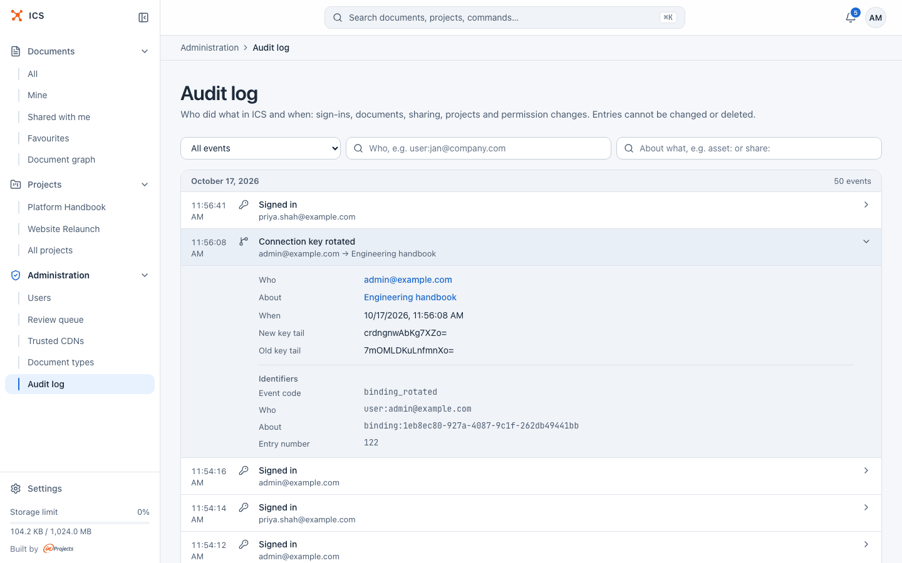

# Keys and security

The private key of a binding is the only thing that lets a CI job publish into an ICS document.
This page covers where to keep it, how to replace it, how to disconnect a repository, and what to
do if the key leaks.

## Where the key is kept

| Piece | Where | Secret? |
|---|---|---|
| Private key | only in the GitLab CI/CD variable `ICS_PRIVATE_KEY`. ICS shows it once when the binding is created or rotated and does not store it. | yes |
| Public key | in ICS, on the binding, and as `public_key` in the binding file | no |
| Binding ID | in ICS, in the binding file and in the sync URL | no |

Keep the private key in GitLab like this:

- **Type File.** The runner writes the key to a temporary file and the variable holds its path,
  so the key does not appear in the job's command line or environment.
- **Protect variable on.** Only pipelines on protected branches and tags receive the key, so a
  merge request from a feature branch cannot publish. Protect the default branch for this to
  work.
- **Narrow environment scope** if you use environments, so that only the sync job's environment
  gets it.
- **Do not copy the key anywhere else**: not into the repository, a wiki or a chat. If you need
  it in another project, create another binding instead. Each binding has its own key.

GitLab cannot mask a File variable, but its value is not printed in the job log, and the CLI
never repeats the key or the key path in its error messages.

## Who can manage bindings

The **Connect a GitLab repo** action, and with it creating bindings, **Rotate key** and
**Delete**, is offered to the document's owner, the owner of its project and ICS
administrators. Project editors and people the document is shared with do not see it.

## Rotate the key

Rotate when someone who had access to the key leaves, when the key may have been exposed, or on
a schedule your team agrees on.

1. In ICS, open the document's **…** menu and choose **Connect a GitLab repo**.
2. Under **Active bindings**, click **Rotate key** on the binding.
3. Confirm **Generate a new key?** with **Generate**.

   

4. The dialog shows the setup screen again with the new private key. In GitLab, open
   **Settings → CI/CD → Variables**, edit `ICS_PRIVATE_KEY` and replace its value with the new
   PEM block.
5. Click **Close and clear from memory**.

What changes and what does not:

| | After rotation |
|---|---|
| Old private key | refused at once: syncs signed with it fail with `403 bad_signature` |
| `binding_id` | unchanged, so the binding file keeps working |
| `public_key` in the binding file | out of date. Update it from the new step 2 block so the file still documents the right key; ICS does not read it. |
| CI job | unchanged |
| Replay clock | reset: the next push is accepted whatever its commit timestamp |
| "last sync" in the binding row | cleared until the next sync |

Pipelines that start between steps 3 and 4 fail with `403`. Re-run them after updating the
variable, or push a new commit.

## Unlink a repository

To stop a repository from publishing:

1. Open **Connect a GitLab repo** on the document.
2. Click **Delete** on the binding and confirm **Remove the GitLab binding?**. ICS warns:
   "Further syncs will be rejected."

The document and all its versions stay as they are, including the ones that came from GitLab.
The next sync from the repository fails with `404 binding_not_found`, so also remove the
`ics:sync` job, the binding file and the `ICS_PRIVATE_KEY` variable from the GitLab project.

A deleted binding cannot be restored. To connect the repository again, create a new binding:
it gets a new ID and a new key, so update both the binding file and the variable.

## What a leaked key allows

Someone who has the private key, and the binding ID from the binding file, can:

- publish new versions of **that one document**, with any content that fits its type and
  limits, as long as the commit timestamp they send is later than the last accepted one.

They cannot:

- read the document or any other content from ICS;
- publish into another document, change the binding or its settings, or create share links;
- delete versions: the earlier content stays in the version history;
- get into GitLab: the key gives no access to the repository.

New versions are shared through the document's existing share links, so a forged version
reaches everyone who can open the document.

## Respond to a leaked key

1. **Rotate the key** in ICS (see above). The leaked key stops working at once.
2. **Put the new key into GitLab** and check how the old one leaked: a job log, a copy in the
   repository, someone's notes.
3. **Check the version history** of the document. Open the **History** tab or **Versions (N)**
   and look for versions you cannot match to a pipeline. An administrator can filter the
   **Audit log** for "Synced from repository" entries: each records the commit SHA and timestamp
   the job sent.
4. **Restore the last good version** from the **Versions** dialog if needed. Restoring creates a
   new version with the old content, so history stays complete. Then fix the repository: the
   next sync publishes whatever is on the default branch.

The audit log records binding events under these names: "Repository connected",
"Repository connection changed", "Connection key rotated", "Repository disconnected",
"Synced from repository" and "Repository sync failed". Each entry names the bound document, and a
rotation entry also shows the last characters of the new and the old public key (**New key tail**,
**Old key tail**), so you can match them with the `public_key` in the binding file. A failed sync is logged for an unknown
binding or a bad signature, so a burst of "Repository sync failed" entries can mean that
someone is trying keys against the binding.

## Related

- [How it works](how-it-works.md)
- [Set up a repository](setup.md)
- [Troubleshooting](troubleshooting.md)
