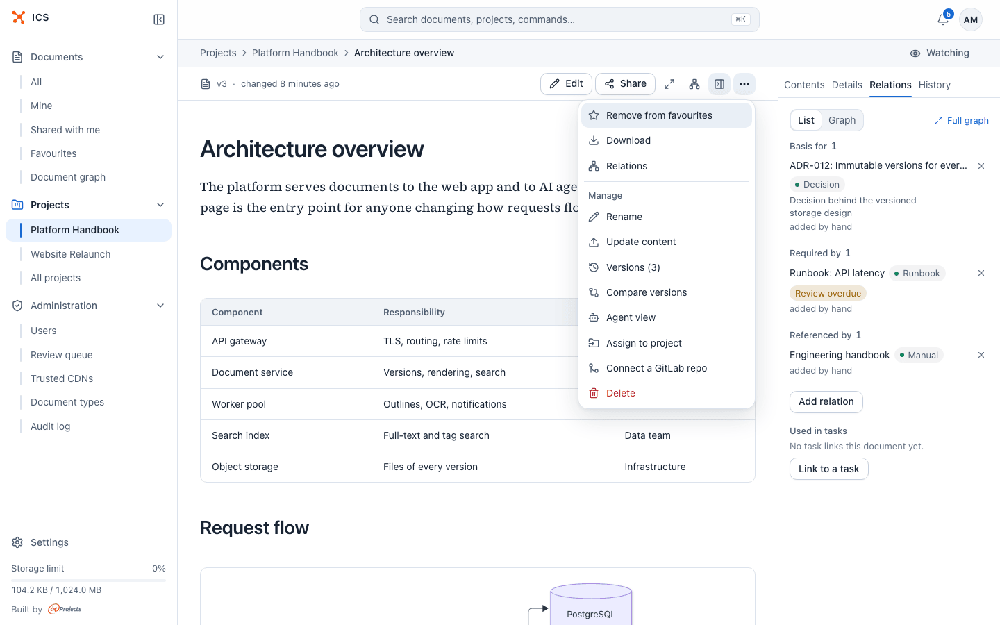
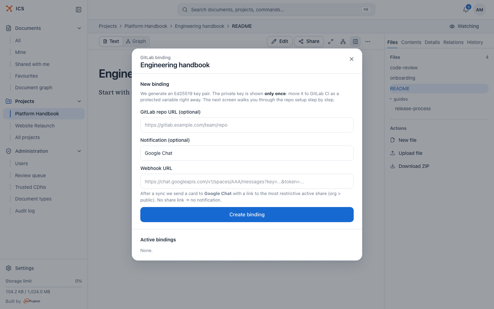
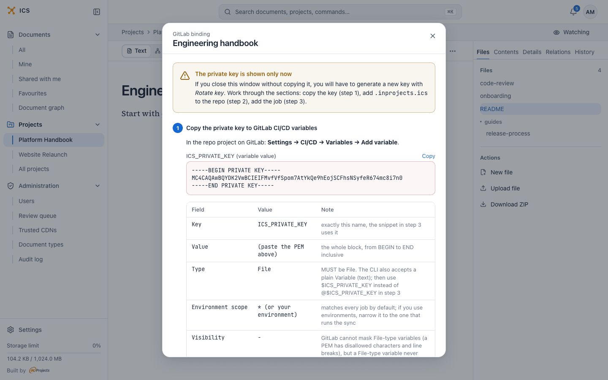
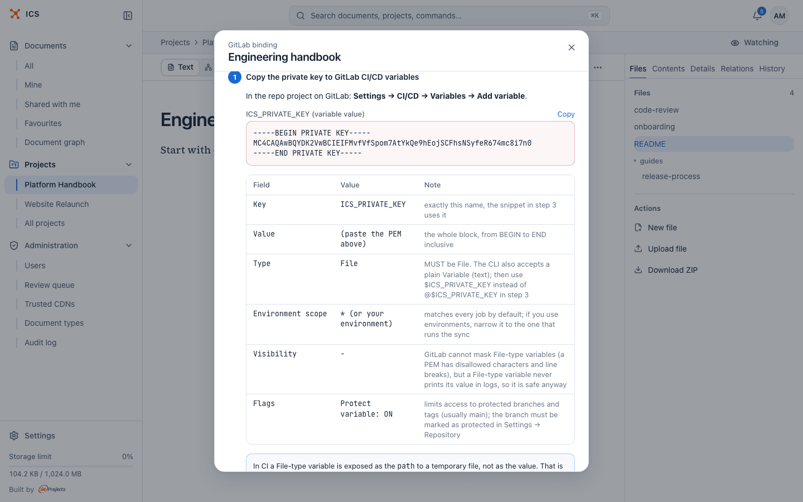
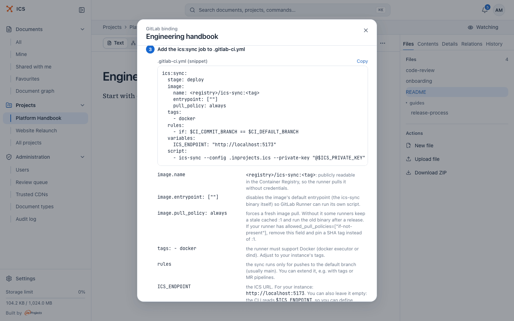
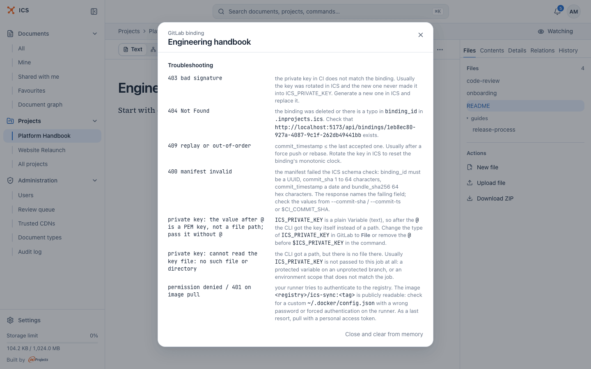
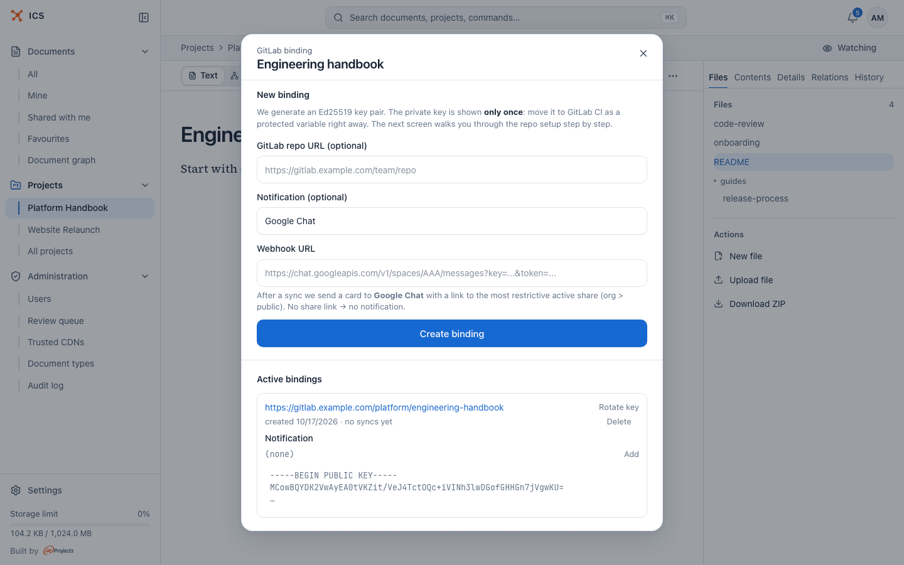

# Set up a repository to publish into ICS

This walkthrough connects a GitLab repository to an ICS document: you create a binding in ICS,
store its private key in GitLab, commit a small config file, add a CI job and check the first
synced version.

## Before you start

You need:

- **A document in ICS** to publish into, of the type that matches your content: a Markdown
  document, a Markdown collection or an HTML bundle. The binding publishes into an existing
  document, so upload a first version by hand if the document does not exist yet.
- **Owner rights on that document**: you own it, you own the project it belongs to, or you are
  an ICS administrator. Only then does the document's menu offer **Connect a GitLab repo**.
- **Permission to edit CI/CD settings** of the GitLab project, to add a variable.
- **A runner that runs Docker images** and can reach your ICS instance over HTTP(S). ICS never
  connects to GitLab, so the network path only has to work from the runner to ICS.
- **A protected default branch** in GitLab, if you follow the recommendation to make the key a
  protected variable (protected variables are exposed only to protected branches and tags).

> [!WARNING]
> Each sync replaces the whole content of the document with what is in the repository. Edits
> made in ICS between syncs stay in the version history but are gone from the current version
> after the next push.

## 1. Create the binding in ICS

1. Open the document in ICS.
2. Open the **…** menu in the toolbar and choose **Connect a GitLab repo**. The same action is
   in the **…** menu of the document's row in the documents list.

   

3. In the **GitLab binding** dialog, fill in the optional fields under **New binding**:

   | Field | What it does |
   |---|---|
   | **GitLab repo URL (optional)** | A link shown on the binding, so others can find the repository. ICS does not use it to connect. |
   | **Notification (optional)** | The chat service for a card after each sync. The list currently offers Google Chat (picked by default) and **No notification**. |
   | **Webhook URL** | The incoming webhook of the chat space. Pick **No notification**, or leave the URL empty, if you do not want notifications. |

   

   A chat card is sent only when the document has an active organisation or public share link,
   because the card links to it ("No share link → no notification"). You can add or change the
   webhook later in the binding row.

4. Click **Create binding**.

ICS generates a key pair and switches the dialog to a three-step setup screen. The amber box at
the top, **The private key is shown only now**, means exactly that: ICS does not keep the
private key, and once you close the dialog the only way to get a working key is to generate a
new one with **Rotate key**. Keep the dialog open until you have finished step 2 below.



## 2. Add the private key to GitLab

In the GitLab project, go to **Settings → CI/CD → Variables → Add variable** and fill it in as
the table in step 1 of the dialog says. Click **Copy** next to **ICS_PRIVATE_KEY (variable
value)** to copy the key.



| GitLab field | Value | Why |
|---|---|---|
| Key | `ICS_PRIVATE_KEY` | the CI job below uses this name |
| Value | the whole PEM block, including its BEGIN and END lines | a partial key does not parse |
| Type | **File** | GitLab writes the value to a temporary file and puts the file's path in the variable, so the key never appears on a command line |
| Environment scope | `*`, or the environment of the sync job | narrower is better if you use environments |
| Visibility | leave as is | GitLab cannot mask a File variable, but its value is not printed in the job log |
| Flags | **Protect variable** on | only pipelines on protected branches and tags get the key |

> [!TIP]
> A plain **Variable** type works too. Then leave out `--private-key` from the job's command:
> the CLI reads the PEM from `$ICS_PRIVATE_KEY` by itself. Do not combine a plain variable with
> `--private-key "@$ICS_PRIVATE_KEY"`; see
> [Troubleshooting](troubleshooting.md#the-key-file-cannot-be-opened).

## 3. Commit the binding file

Step 2 of the dialog, **Add .inprojects.ics to the repo root**, shows the binding file filled in
for your document. Click **Copy** and save it as `.inprojects.ics` in the root of the
repository.


```yaml
# .inprojects.ics
version: 1
binding_id: 1eb8ec80-927a-4087-9c1f-262db49441bb
public_key: |
  -----BEGIN PUBLIC KEY-----
  MCowBQYDK2VwAyEA...
  -----END PUBLIC KEY-----
publish:
  source: .
  kind: md_collection
  # exclude:
  #   - "node_modules/**"
metadata:
  title: "Engineering handbook"
```

The file holds the binding ID and the **public** key, never the private one, so it is safe to
commit. Before committing, decide what to publish:

- `source: .` publishes the whole repository. Change it to a folder, for example `docs`, to
  publish only that folder.
- Add excludes for files that do not belong in the document. The CI config and the binding file
  are uploaded too unless you exclude them.

[The binding file](binding-file.md) describes every field and has ready recipes.

## 4. Add the CI job

Step 3 of the dialog, **Add the ics:sync job to .gitlab-ci.yml**, shows a job with the ICS
address already filled in. Copy it into `.gitlab-ci.yml`.



```yaml
ics:sync:
  stage: deploy
  image:
    name: ghcr.io/inprojectspl/ics-sync:1
    entrypoint: [""]
    pull_policy: always
  tags:
    - docker
  rules:
    - if: $CI_COMMIT_BRANCH == $CI_DEFAULT_BRANCH
  variables:
    ICS_ENDPOINT: "https://ics.example.com"
  script:
    - ics-sync --config .inprojects.ics --private-key "@$ICS_PRIVATE_KEY"
```

Check three things before you commit:

1. **The image.** If the snippet shows `<registry>/ics-sync:<tag>`, your ICS administrator has
   not set `ICS_SYNC_IMAGE`. Use `ghcr.io/inprojectspl/ics-sync:1`, the public image.
2. **The runner tags.** The snippet asks for a runner tagged `docker`. Change or remove `tags:`
   to match the runners of your GitLab instance.
3. **The stage.** `deploy` must be one of the stages of your pipeline. If your `.gitlab-ci.yml`
   defines `stages:` without `deploy`, add it or pick another stage.

`ICS_ENDPOINT` is the address you opened ICS at. You can delete it from the job and define it
as a project or group CI/CD variable instead.

More variants (after a build job, pinned tags, several documents) are in
[CI job recipes](ci-recipes.md).

The end of the setup screen has a short **Troubleshooting** list for the most common errors.
[Troubleshooting](troubleshooting.md) has the full list.



## 5. Close the dialog

When the variable is saved in GitLab, click **Close and clear from memory** at the bottom of the
setup screen. The private key is removed from the page. The binding now appears under
**Active bindings** with "no syncs yet".



## 6. Push and watch the job

Commit `.inprojects.ics` and the CI change to the default branch and push. In the pipeline, the
`ics:sync` job runs the CLI. On success it prints the response from ICS, for example:

```json
{"version":5,"entry_path":"README.md","file_count":4,"size_bytes":2311,"commit_sha":"9f2c1e7a4b8d0c3f5e6a7b9c1d2e3f4a5b6c7d8e","security_status":"clean"}
```

- `version` is the new version number of the document.
- `entry_path` is the file ICS opens first: for a collection the shallowest `README.md` or
  `index.md`, for an HTML bundle the shallowest `index.html`.
- `security_status` is the result of the content scan; see
  [the note on HTML bundles](#html-bundles-and-the-security-scan).

For more detail in the log, add `-v` to the command. The CLI then also prints the binding, the
source folder and the number of files and bytes in the bundle.

If the job fails, the last line of its log names the problem. Look it up in
[Troubleshooting](troubleshooting.md).

## 7. Confirm the new version in ICS

1. Open the document. The toolbar shows the new version number.
2. Open the side panel and its **History** tab, or choose **Versions (N)** in the **…** menu.
   The synced version is at the top, marked **Current**. Its author is the person who created
   the binding; a synced version has no change note.

   

   (The screenshot shows another document; a synced version looks the same.)

3. Open **Connect a GitLab repo** again: the binding row now says "last sync" with the date
   instead of "no syncs yet".

Other signs that the binding works:

- In the documents list the document's row shows a **GitLab** badge ("Synced with GitLab").
  The **Filters** button offers a **Source** group with **Synced from GitLab** and **Manual**
  when the list has documents of both kinds.
- People watching the document get a notification from "GitLab sync".
- Administrators see a "Synced from repository" entry in **Audit log**.

## HTML bundles and the security scan

ICS scans every version of an HTML bundle, including synced ones. If the scanner marks a
version critical, `security_status` in the job output is `critical`, the job still succeeds, and
the version waits in the administrators' review queue before it can be shared. An approval
applies to one version only, so a later sync that is still critical goes back into the queue.

## Related

- [How it works](how-it-works.md)
- [The binding file](binding-file.md)
- [CI job recipes](ci-recipes.md)
- [Keys and security](keys-and-security.md)
- [Troubleshooting](troubleshooting.md)
